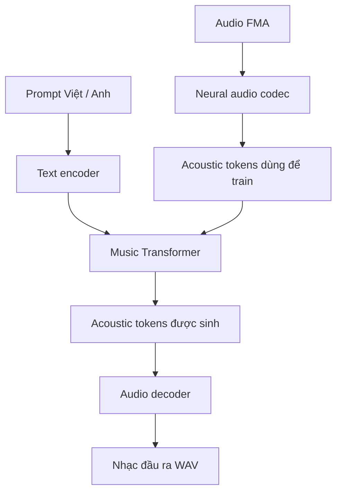

# MusicGenAI — Text-to-Music huấn luyện từ đầu

MusicGenAI là dự án thử nghiệm sinh nhạc từ mô tả văn bản trên bộ dữ liệu
[FMA Small](https://github.com/mdeff/fma). Toàn bộ tokenizer, text encoder, neural
audio codec và Music Transformer đều được định nghĩa và huấn luyện trong dự án;
không sử dụng T5, EnCodec hay trọng số pretrained.

> **Trạng thái:** dự án mang tính nghiên cứu/thử nghiệm. Chất lượng nhạc đầu ra phụ
> thuộc trực tiếp vào chất lượng tái tạo của audio codec và thời gian huấn luyện.

## Kiến trúc



Pipeline có hai giai đoạn huấn luyện, sau đó dùng các mô hình đã huấn luyện để sinh nhạc:

| Giai đoạn | Đầu vào | Xử lý | Kết quả |
|---|---|---|---|
| 1. Huấn luyện codec | Audio FMA 32 kHz | CNN Encoder → RVQ → CNN Decoder | Codec có thể biến audio thành token và tái tạo lại audio |
| 2. Huấn luyện Transformer | Prompt + acoustic token từ codec | Text Encoder → Music Transformer | Mô hình dự đoán acoustic token theo prompt |
| 3. Sinh nhạc | Prompt Việt hoặc Anh | Transformer sinh token → codec giải mã | File WAV 32 kHz |

Các thành phần chính:

- **Neural audio codec:** nén audio thành 8 codebook token ở tốc độ 50 frame/giây.
- **Text encoder:** mã hóa trực tiếp prompt bằng UTF-8 byte tokenizer.
- **Music Transformer:** học quan hệ giữa prompt và acoustic token bằng cross-attention.
- **Audio decoder:** chuyển acoustic token do Transformer sinh ra thành waveform.

## Tính năng chính

- Huấn luyện toàn bộ mô hình từ đầu, không dùng model hoặc tokenizer pretrained.
- Nhận prompt tiếng Việt và tiếng Anh bằng UTF-8 byte tokenizer.
- Neural codec CNN kết hợp Residual Vector Quantizer (RVQ).
- 8 codebook × 1.024 code ở 50 frame/giây, bitrate xấp xỉ 4 kbps.
- Transformer decoder dùng delay pattern và classifier-free guidance (CFG).
- Chia train/validation/test theo track để tránh rò rỉ giữa các đoạn cùng bài hát.
- Tự loại audio hỏng, rỗng, chứa NaN/Inf hoặc quá im lặng.
- Hỗ trợ cache token, resume huấn luyện và lưu latest/best checkpoint.
- Có CLI đánh giá/sinh nhạc và giao diện web FastAPI với lịch sử SQLite.

## Yêu cầu

- Windows 10/11.
- Python 3.12 trở lên.
- [uv](https://docs.astral.sh/uv/) để quản lý môi trường và dependency.
- GPU NVIDIA hỗ trợ CUDA được khuyến nghị; cấu hình mặc định hướng tới GPU từ 4 GB VRAM.
- Đủ dung lượng cho FMA Small, cache token, checkpoint và audio đầu ra.
- Internet trong lần đầu cài dependency và tải dữ liệu.

## Cài đặt

```powershell
git clone https://github.com/dinhmanhctnk33/MusicGenAI_SIC.git
cd MusicGenAI_SIC
uv sync
```

Kiểm tra PyTorch có nhận GPU hay không:

```powershell
uv run python -c "import torch; print(torch.cuda.is_available()); print(torch.cuda.get_device_name(0) if torch.cuda.is_available() else 'CPU')"
```

## Bắt đầu nhanh

### 1. Huấn luyện neural audio codec

Huấn luyện mới hoàn toàn:

```powershell
$env:MUSICGEN_CODEC_RESUME = "none"
uv run train_codec.py
```

Kết quả được lưu trong `checkpoints/neural_codec_v1/`:

```text
latest_codec.pt
best_codec.pt
original_best.wav
reconstruction_best.wav
```

Mặc định, chương trình tự tiếp tục từ `latest_codec.pt` nếu file tồn tại:

```powershell
Remove-Item Env:MUSICGEN_CODEC_RESUME -ErrorAction SilentlyContinue
uv run train_codec.py
```

Trước khi sang bước tiếp theo, hãy nghe `original_best.wav` và
`reconstruction_best.wav`. Bản tái tạo cần nghe rõ nội dung nhạc, không im lặng và
không chỉ có tiếng ù; Transformer không thể khôi phục thông tin mà codec đã làm mất.

### 2. Tạo cache và huấn luyện Music Transformer

Huấn luyện mới hoàn toàn:

```powershell
$env:MUSICGEN_RESUME = "none"
uv run train.py
```

`train.py` sẽ tự động:

1. Nạp `checkpoints/neural_codec_v1/best_codec.pt`.
2. Kiểm tra và loại các track không hợp lệ.
3. Tạo những acoustic token còn thiếu trong cache.
4. Chia dữ liệu theo track.
5. Huấn luyện, validation, early stopping và lưu checkpoint.

Checkpoint Music Transformer được lưu tại
`checkpoints/neural_codec_bilingual_v5/`. Để tiếp tục từ
`latest_musicgen_model.pt`:

```powershell
Remove-Item Env:MUSICGEN_RESUME -ErrorAction SilentlyContinue
uv run train.py
```

## Đánh giá

Đánh giá best checkpoint trên test split được giữ riêng:

```powershell
uv run test.py --mode evaluate `
  --checkpoint checkpoints/neural_codec_bilingual_v5/best_musicgen_model.pt
```

## Sinh nhạc

```powershell
uv run test.py --mode generate `
  --checkpoint checkpoints/neural_codec_bilingual_v5/best_musicgen_model.pt `
  --prompt "Một bản nhạc Rock sôi động với guitar điện và trống mạnh mẽ." `
  --duration 5 `
  --output outputs/rock_vi.wav
```

Các tùy chọn đáng chú ý:

| Tùy chọn | Mặc định | Ý nghĩa |
|---|---:|---|
| `--duration` | `5.0` | Độ dài audio (giây) |
| `--temperature` | `0.8` | Độ ngẫu nhiên khi sampling |
| `--top-k` | `50` | Giới hạn token ứng viên |
| `--guidance-scale` | `2.5` | Cường độ bám theo prompt |
| `--device` | tự chọn | `cpu` hoặc `cuda` |

## Chạy giao diện web

```powershell
uv run uvicorn frontend.app:app --host 127.0.0.1 --port 8000
```

Sau đó mở [http://127.0.0.1:8000](http://127.0.0.1:8000). Frontend ưu tiên
`best_musicgen_model.pt`, sau đó mới dùng latest checkpoint. Lịch sử được lưu cục
bộ trong `musicgen_history.sqlite3`.

## Dữ liệu và cache

FMA Small được tải tự động vào `dataset/`. Mỗi track tạo tối đa 6 đoạn dài 5 giây
trước khi lọc track lỗi. Mỗi cache item gồm:

- `audio_tokens`: tensor `[8, 250]`.
- `text_token_ids`: tensor `[64]`.
- `text_attention_mask`: tensor `[64]`.
- Prompt, genre, track ID và segment index.

Cache hiện tại nằm tại:

```text
dataset/encoded_cache_v5_neural_codec_bilingual/sr32000_duration5000ms/
```

Danh sách track lỗi được ghi vào `dataset/invalid_tracks.csv`. Cache v1–v4 và các
checkpoint dùng T5, EnCodec hoặc codec DCT không tương thích với pipeline hiện tại.

## Cấu hình mặc định

### Neural audio codec

| Thông số | Giá trị |
|---|---:|
| Sample rate | 32.000 Hz |
| Độ dài crop train | 2 giây |
| Token rate | 50 frame/giây |
| Codebook | 8 × 1.024 code |
| Latent dimension | 128 |
| Batch size | 2 |
| Epoch tối đa | 50 |
| Early stopping patience | 7 |

Codec dùng waveform L1 loss, multi-resolution STFT loss và RVQ commitment loss.

### Music Transformer

| Thông số | Giá trị |
|---|---:|
| Audio mỗi sample | 5 giây |
| Text length | 64 byte token |
| `d_model` | 384 |
| Decoder layers | 6 |
| Attention heads | 8 |
| Feed-forward dimension | 1.536 |
| Batch size | 1 |
| Gradient accumulation | 16 |
| Epoch tối đa | 30 |
| Early stopping patience | 5 |

Các cấu hình tập trung trong `config.py`. Accuracy là tỷ lệ acoustic token top-1
trùng target và chỉ nên xem như metric phụ; validation loss, chất lượng codec
reconstruction và audio sinh thực tế quan trọng hơn.

## Cấu trúc dự án

```text
Music-GenAI/
├── audio_codec.py          # CNN encoder/decoder, RVQ và STFT loss
├── train_codec.py          # Huấn luyện neural audio codec
├── scratch_components.py  # ByteTokenizer và text encoder
├── data.py                 # FMA loader, làm sạch, crop và token cache
├── model.py                # Music Transformer và CFG generation
├── train.py                # Huấn luyện/validation/test MusicGen
├── test.py                 # Đánh giá và sinh WAV/MP3
├── config.py               # Cấu hình tập trung
└── frontend/               # FastAPI và giao diện web
```

## Lưu ý

- Không huấn luyện Music Transformer trước khi codec reconstruction đạt chất lượng chấp nhận được.
- Khi đổi kiến trúc codec, số codebook hoặc codebook size, cần tạo lại cache và huấn luyện lại Music Transformer.
- Nếu CUDA hết bộ nhớ, giảm `CODEC_TRAIN_CONFIG["batch_size"]` trong `config.py` xuống `1`.
- Dataset, cache, checkpoint, audio đầu ra và SQLite cục bộ đã được loại khỏi Git qua `.gitignore`.
- FMA có giấy phép riêng cho metadata và từng track; người dùng cần tuân thủ giấy phép của [Free Music Archive](https://github.com/mdeff/fma).
